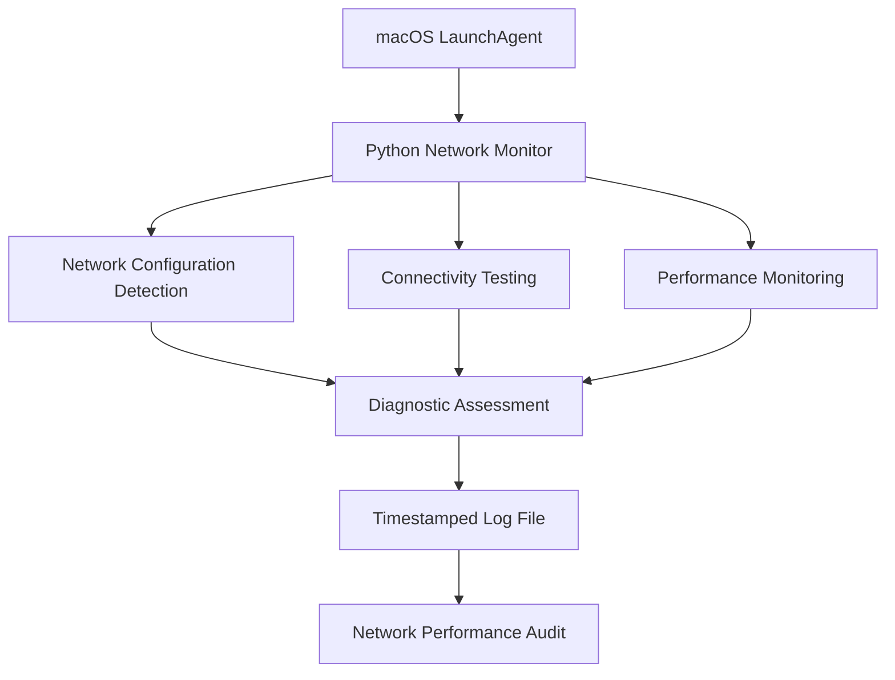

# Network Health Monitor

An automated network diagnostic and performance monitoring utility designed for macOS.

## Project Overview

I completed this project as an independent technical learning exercise while pursuing my B.S. in Cloud and Network Engineering (AWS) at Western Governors University.

My objective was to implement, validate and deploy an automated network monitoring tool capable of identifying connectivity issues, collecting historical performance data and supporting systematic network troubleshooting.

The project was completed entirely on my personal MacBook without additional hardware, paid software or cloud infrastructure.

## Project Objectives

- Automate routine network diagnostics.
- Identify potential connectivity and DNS issues.
- Monitor network latency and packet loss.
- Maintain historical diagnostic records.
- Implement unattended background monitoring.
- Apply networking fundamentals in a real-world environment.
- Utilize diagnostic data to conduct network performance audits.

## Technologies Utilized

| Technology | Application |
|---|---|
| Python 3.14.7 | Network diagnostic automation |
| macOS | Host operating system |
| Zsh | Command-line administration |
| Git | Version control |
| XML | Background service configuration |
| launchd | Automated task scheduling |
| ICMP | Network reachability testing |
| DNS | Hostname resolution testing |
| HTTPS | Web connectivity verification |
| UDP | Local IPv4 address detection |

## System Functionality

The monitoring utility automatically collects the following information:

- System hostname
- Local IPv4 address
- Default gateway
- Gateway ICMP response
- External network connectivity
- DNS resolution
- Minimum, average and maximum latency
- Latency standard deviation
- Packet loss
- HTTPS connectivity
- Rule-based diagnostic assessments
- Timestamped historical records

## System Architecture



## Automated Execution

The utility was configured using a macOS LaunchAgent to execute automatically every 900 seconds, or 15 minutes.

Recurring background execution was validated through consecutive timestamped log entries without manually executing the monitoring script.

The service operates under standard user privileges and does not require administrator access.

## Network Performance Testing

Testing was conducted across two live network environments:

- Mobile cellular hotspot
- Mint residential Wi-Fi

### Comparative Results

| Metric | Mobile Hotspot | Residential Wi-Fi |
|---|---:|---:|
| Minimum latency | 38.256 ms | 34.601 ms |
| Average latency | 65.919 ms | 54.871 ms |
| Maximum latency | 88.861 ms | 70.178 ms |
| Latency standard deviation | 18.998 ms | 12.272 ms |
| Packet loss | 0% | 0% |
| Gateway ICMP response | FAIL | PASS |
| External connectivity | PASS | PASS |
| DNS resolution | PASS | PASS |
| HTTPS connectivity | PASS | PASS |

These measurements represent individual diagnostic samples and are not intended to establish long-term network performance guarantees.

## Troubleshooting and Findings

### Gateway ICMP Nonresponse

During mobile hotspot testing, the utility consistently reported a failed gateway ping despite successful external connectivity and DNS resolution.

I independently verified the results using native terminal commands and determined that the failed gateway response alone was insufficient evidence of a network outage.

Potential ICMP filtering was identified as a possible explanation, although the exact cause was not confirmed.

The utility subsequently incorporated rule-based diagnostic assessments to distinguish gateway ICMP nonresponse from operational web connectivity.

### Controlled Network Outage

I deliberately disconnected the host device from its network to validate application behavior during a connectivity failure.

| Diagnostic | Result |
|---|---|
| Local IPv4 route | Unavailable |
| Default gateway | Not found |
| Gateway testing | Correctly skipped |
| External connectivity | Failed |
| DNS resolution | Failed |
| Packet loss | 100% |
| HTTPS connectivity | Failed |
| Historical logging | Successful |
| Application stability | Successful |

The utility completed its execution and recorded the failed diagnostics without crashing.

### Dynamic Network Configuration

The utility successfully detected changes to local IPv4 addresses and default gateways when reconnecting to and transitioning between different networks.

No manual reconfiguration of the monitoring script was required.

## Installation and Usage

### Requirements

- macOS
- Python 3
- Terminal access

No external Python libraries are required.

Run the following command from the project directory:

```bash
python3 network_monitor.py
```

Diagnostic reports are automatically appended to:

```text
logs/network_report.txt
```

## Security and Privacy

- The monitoring utility operates locally.
- Administrative privileges are not required for normal operation.
- Private diagnostic logs are excluded from version control using `.gitignore`.
- No credentials or API keys are required.
- Diagnostic traffic is limited to designated connectivity test destinations.
- Historical diagnostic records are not included in the public repository.

## Known Limitations

- Currently designed for macOS.
- ICMP nonresponse does not necessarily indicate a network outage.
- Individual performance tests utilize a limited number of packets.
- Diagnostic assessments are preliminary and rule-based.
- Monitoring does not continuously execute while the host is asleep or powered off.
- Automatic log rotation has not been implemented.
- The final rule-based offline assessment requires additional validation.
- Background scheduling requires local LaunchAgent configuration.

## AI-Assisted Development Disclosure

OpenAI's ChatGPT was utilized to generate the Python source code and assist with technical implementation and documentation.

My responsibilities included:

- Project implementation and deployment.
- Terminal-based system administration.
- Debugging and correcting implementation errors.
- Independently verifying diagnostic functionality.
- Configuring automated background execution.
- Conducting controlled network failure testing.
- Independently interpreting initial network diagnostic results.
- Validating functionality across multiple network environments.

The comparative network performance analysis and project documentation were completed with AI assistance.

The primary purpose of this project was to demonstrate my ability to implement, validate and effectively utilize automation tools to support network administration and troubleshooting, rather than demonstrate independent software development proficiency.

## Future Improvements

- Cross-platform compatibility
- Automated log rotation
- Structured CSV or JSON reporting
- Network performance visualization
- Configurable diagnostic destinations
- Automated connectivity alerts
- Cloud-based monitoring integration

## Project Information

**Project:** Network Health Monitor

**Version:** 1.0

**Completed:** November 25, 2026

**Category:** Networking, Infrastructure Automation and System Administration

**Additional Infrastructure Cost:** $0

**Academic Level:** Undergraduate — Sophomore

